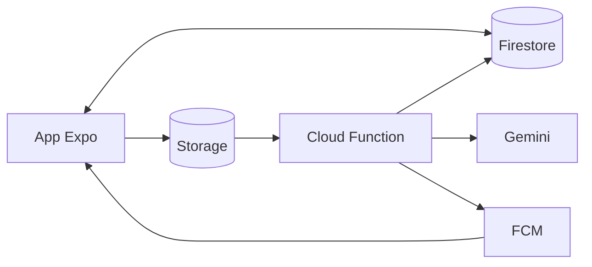

# EcoReporte

App móvil de reporte ciudadano de residuos: foto + ubicación GPS, clasificación con IA (Gemini), funcionamiento sin conexión y alertas para la entidad de aseo.

> **Estado:** en construcción (bloque 0 de 4). Plan y avance en [`docs/README.md`](docs/README.md).

## Qué demuestra

| Área         | Cómo                                                                                                                                                             |
| ------------ | ---------------------------------------------------------------------------------------------------------------------------------------------------------------- |
| React Native | Expo SDK 58, Expo Router, TypeScript estricto, development build con módulos nativos                                                                             |
| Firebase     | Auth con roles por custom claims, Firestore offline y en tiempo real, Storage, reglas probadas, Cloud Functions, FCM, App Check, Crashlytics, Remote Config      |
| Google Cloud | Gemini con salida estructurada y proveedor intercambiable (API gratuita en desarrollo, Vertex AI proyectado), IAM de mínimo privilegio, WIF y costos proyectados |
| Ingeniería   | ADR, parametrización documentada, pruebas, CI en GitHub Actions, EAS Build                                                                                       |

## Arquitectura en una imagen



Detalle en [`docs/02-arquitectura.md`](docs/02-arquitectura.md).

## Costo cero

El proyecto se desarrolla sin presupuesto ([ADR 0007](docs/adr/0007-costo-cero-con-spark-y-emuladores.md)):

- Firebase corre en la **Emulator Suite**.
- El proyecto en la nube usa el plan gratuito (Spark), solo para FCM, Crashlytics, Analytics y Remote Config.
- La IA usa la capa gratuita de Gemini.
- El mapa usa MapLibre con teselas abiertas.

La producción en Blaze con Vertex AI está diseñada y costeada en [`docs/04-infraestructura.md`](docs/04-infraestructura.md), pero no está activa.

## Ejecutar en local

Requisitos: Node 24, Android Studio con un emulador, JDK 21 (en Windows sirve el que trae Android Studio) y el `google-services.json` de `ecoreporte-dev` en la raíz (ver [`docs/04-infraestructura.md`](docs/04-infraestructura.md)).

```bash
npm install
cp .env.example .env
npm run verify          # typecheck + lint + formato + pruebas
npm run android         # compila el development build y lo instala en el emulador
```

En Windows, antes del primer `npm run android` (PowerShell):

```powershell
$env:JAVA_HOME = "C:\Program Files\Android\Android Studio\jbr"
$env:ANDROID_HOME = "$env:LOCALAPPDATA\Android\Sdk"
```

La configuración de Firebase (`google-services.json`) no está en el repositorio: ver [`docs/04-infraestructura.md`](docs/04-infraestructura.md).

## Origen

Implementación del documento de ingeniería **EcoReport AI** (UTS, 2025). Las diferencias con ese diseño están en [`docs/adr/0002`](docs/adr/0002-firebase-gcp-en-lugar-de-la-pila-original.md).

## Licencia

MIT
