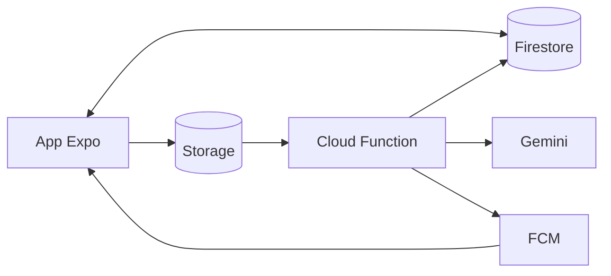

# EcoReporte

App móvil de reporte ciudadano de residuos: foto + ubicación GPS, clasificación con IA (Gemini), funcionamiento sin conexión y alertas para la entidad de aseo.

> **Estado:** en construcción (bloque 0 de 4). Plan y avance en [`docs/README.md`](docs/README.md).

## Qué demuestra

| Área         | Cómo                                                                                                                                                             |
| ------------ | ---------------------------------------------------------------------------------------------------------------------------------------------------------------- |
| React Native | Expo SDK 58, Expo Router, TypeScript estricto, development build con módulos nativos                                                                             |
| Firebase     | Auth con roles por custom claims, Firestore offline y en tiempo real, Storage, reglas probadas, Cloud Functions, FCM, App Check, Crashlytics, Remote Config      |
| Google Cloud | Gemini con salida estructurada y proveedor intercambiable (API gratuita en desarrollo, Vertex AI proyectado), IAM de mínimo privilegio, WIF y costos proyectados |
| Ingeniería   | ADR, parametrización documentada, pruebas, CI en GitHub Actions, EAS Build                                                                                       |

## Arquitectura en una imagen



Detalle en [`docs/02-arquitectura.md`](docs/02-arquitectura.md).

## Costo cero

El proyecto se desarrolla sin presupuesto ([ADR 0007](docs/adr/0007-costo-cero-con-spark-y-emuladores.md)):

- Firebase corre en la **Emulator Suite**.
- El proyecto en la nube usa el plan gratuito (Spark), solo para FCM, Crashlytics, Analytics y Remote Config.
- La IA usa la capa gratuita de Gemini.
- El mapa usa MapLibre con teselas abiertas.

La producción en Blaze con Vertex AI está diseñada y costeada en [`docs/04-infraestructura.md`](docs/04-infraestructura.md), pero no está activa.

## Ejecutar en local

Requisitos:

- Node 24 (React Native 0.88 exige 22.13+ o 24.3+).
- Android Studio con un emulador.
- JDK 21. En Windows sirve el que trae Android Studio.
- En Windows, CMake 3.31 o superior en el SDK: Android Studio → SDK Manager → SDK Tools → CMake, con «Show Package Details» marcado. Ver «Rutas largas en Windows», más abajo.
- El `google-services.json` de `ecoreporte-dev` en la raíz (ver [`docs/04-infraestructura.md`](docs/04-infraestructura.md)).

```bash
npm install
cp .env.example .env
npm run verify          # typecheck + lint + formato + pruebas
npm run android         # compila el development build y lo instala en el emulador
```

En Windows (PowerShell), cada terminal nueva se prepara con:

```powershell
. .\scripts\entorno-android.ps1   # Java 21 de Android Studio, ANDROID_HOME, adb y emulator
```

**Rutas largas en Windows:** las rutas de compilación de C++ de `react-native-worklets` y `react-native-screens` pasan de 260 caracteres. El CMake 3.22 del SDK trae ninja 1.10, que falla con `ninja: error: mkdir(...)`. Con CMake 3.31 o superior instalado, después de generar `android/` (el primer `npm run android` o `npx expo prebuild --platform android`), agrega esta línea a `android/local.properties`, con tu usuario y tu versión de CMake:

```properties
cmake.dir=C\:\\Users\\<usuario>\\AppData\\Local\\Android\\Sdk\\cmake\\3.31.6
```

`android/` se genera y está fuera de git: después de cada `expo prebuild --clean` se repite este paso.

Para trabajar se usan dos terminales:

```powershell
npm run emulators       # terminal 1: Auth, Firestore y Storage en local (interfaz: http://localhost:4000)
npm run android         # terminal 2: compila, instala en el emulador y arranca Metro
```

**Con un celular físico (recomendado si el PC tiene poca memoria):**

1. Activa la depuración USB en Opciones de desarrollador, conecta el cable y acepta «Permitir depuración USB». `adb devices` debe mostrarlo como `device`.
2. En `.env`: `EXPO_PUBLIC_EMULATOR_HOST=127.0.0.1`.
3. `npm run android:puertos`: con `adb reverse`, el celular llega a los emuladores de Auth, Firestore y Storage del PC por el cable, sin Wi-Fi ni firewall. Se repite cada vez que se reconecta el cable.
4. `npm run android`: Expo detecta el celular, compila en el PC y lo instala.

**Memoria:**

- La compilación ocurre siempre en el PC. Gradle necesita unos 4 GB libres; con el emulador de Android, unos 6 GB.
- Si el emulador no arranca solo, ábrelo desde el Device Manager de Android Studio antes de `npm run android`.

La configuración de Firebase (`google-services.json`) no está en el repositorio: ver [`docs/04-infraestructura.md`](docs/04-infraestructura.md).

## Origen

Implementación del documento de ingeniería **EcoReport AI** (UTS, 2025). Las diferencias con ese diseño están en [`docs/adr/0002`](docs/adr/0002-firebase-gcp-en-lugar-de-la-pila-original.md).

## Licencia

MIT
