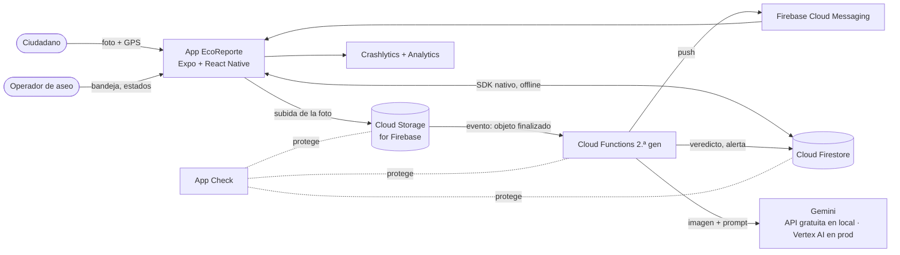
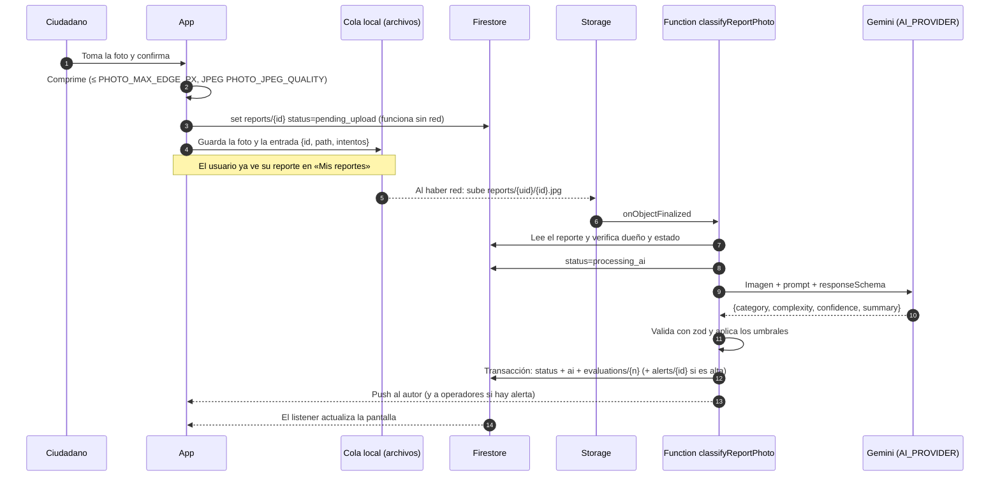
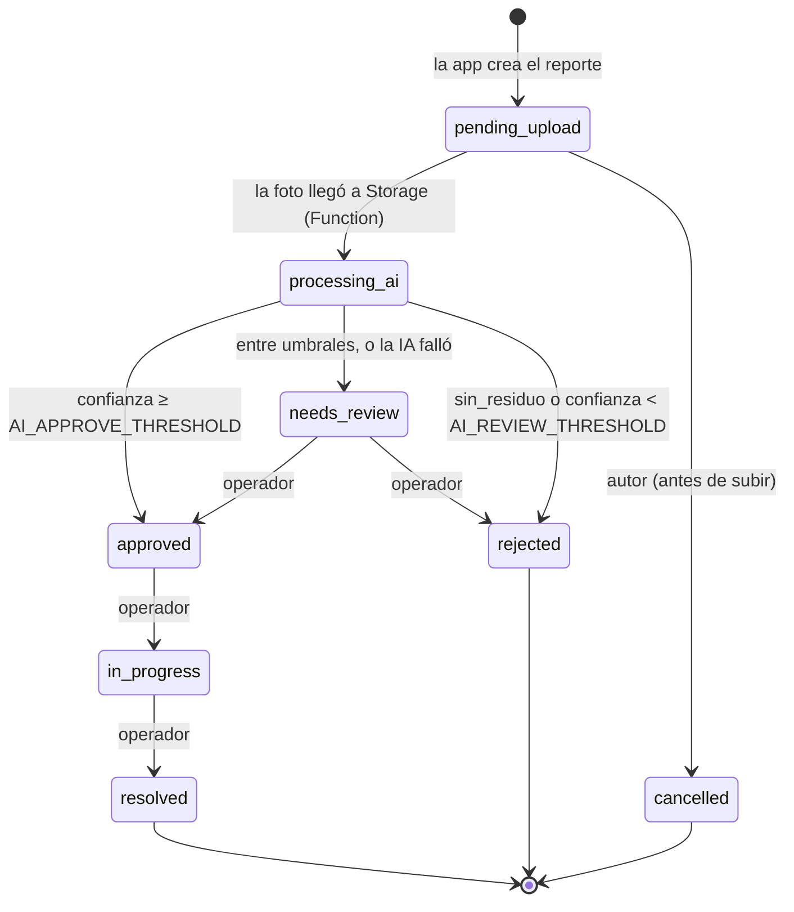

# 02 · Arquitectura

## Contexto



## Contenedores y responsabilidades

| Contenedor                      | Puede                                                                                                                                            | No puede                                                                          |
| ------------------------------- | ------------------------------------------------------------------------------------------------------------------------------------------------ | --------------------------------------------------------------------------------- |
| **App** (`src/`)                | Capturar, guardar en cola local, escribir el reporte en estado `pending_upload`, subir la foto, escuchar cambios, cambiar estados si es operador | Escribir `ai`, `status` de la IA ni alertas. Decidir el veredicto. Tener secretos |
| **Reglas** (`firebase/*.rules`) | Validar forma, dueño, transiciones permitidas y tamaño de la foto                                                                                | Llamar a la IA                                                                    |
| **Functions** (`functions/`)    | Clasificar, escribir el veredicto y el log de la evaluación, crear alertas, enviar push, limpiar                                                 | Confiar en lo que mandó el cliente sin revalidarlo                                |
| **Gemini** (`AI_PROVIDER`)      | Devolver categoría, complejidad, confianza y descripción en JSON con esquema                                                                     | Persistir nada                                                                    |

## Flujo de un reporte



**Por qué el reporte se escribe antes de la IA** (el documento pedía interceptar antes de la base): sin conexión no hay IA, y el reporte no se puede perder. Se escribe en un estado de cuarentena que nadie más ve, y la IA lo promueve o lo descarta. Ver [ADR 0004](adr/0004-reporte-en-cuarentena-hasta-el-veredicto.md).

## Máquina de estados del reporte



- **Visibles en el mapa público:** `approved`, `in_progress` y `resolved` (este último durante `MAP_RESOLVED_VISIBLE_DAYS`).
- **Si la IA falla** (timeout, cuota o respuesta inválida) después de `AI_MAX_ATTEMPTS`, el reporte va a `needs_review`: un error técnico nunca rechaza un reporte.
- **Si `AI_ENABLED=false`**, todo reporte va directo a `needs_review`.
- Las transiciones viven en `src/features/reports/domain/report-status.ts` (con pruebas) y se repiten en las reglas de Firestore.

## Estructura del código

```
ecoreporte/
├── src/
│   ├── app/                    ← solo rutas (Expo Router)
│   │   ├── _layout.tsx
│   │   ├── (tabs)/             ← reportar, mapa, mis reportes, perfil
│   │   └── (auth)/             ← inicio de sesión
│   ├── features/
│   │   ├── auth/
│   │   ├── reports/
│   │   │   ├── domain/         ← tipos, estados, reglas puras (con pruebas)
│   │   │   ├── data/           ← repositorio Firestore + cola de subida
│   │   │   └── ui/
│   │   ├── map/
│   │   └── operator/
│   ├── lib/
│   │   ├── config/             ← lectura y validación de EXPO_PUBLIC_*
│   │   ├── firebase/           ← inicialización y emuladores
│   │   └── geo/                ← geohash y distancias
│   ├── components/  hooks/  constants/
├── functions/                  ← Cloud Functions (TypeScript, paquete propio)
├── firebase/                   ← firestore.rules, storage.rules, índices
├── firebase.json  .firebaserc
├── app.config.ts  eas.json
└── docs/
```

**Fronteras:** las pantallas no importan el SDK de Firebase; usan los hooks y repositorios de `features/*/data`. `domain/` no importa nada de React ni de Firebase.

## Decisiones (ADR)

| #                                                             | Decisión                                                                     |
| ------------------------------------------------------------- | ---------------------------------------------------------------------------- |
| [0001](adr/0001-development-build-y-react-native-firebase.md) | Development build + React Native Firebase (no Expo Go ni el SDK web)         |
| [0002](adr/0002-firebase-gcp-en-lugar-de-la-pila-original.md) | Firebase y GCP en lugar de Spring Boot + PostgreSQL + TFLite                 |
| [0003](adr/0003-ia-en-servidor-con-gemini.md)                 | IA en el servidor con Gemini y salida estructurada; umbrales como parámetros |
| [0004](adr/0004-reporte-en-cuarentena-hasta-el-veredicto.md)  | El reporte se escribe primero y queda en cuarentena hasta el veredicto       |
| [0005](adr/0005-entornos-y-region.md)                         | Entornos (local, dev, prod) y región `us-east1`                              |
| [0006](adr/0006-alertas-con-fcm-y-listeners.md)               | Alertas con FCM y listeners en lugar de WebSocket                            |
| [0007](adr/0007-costo-cero-con-spark-y-emuladores.md)         | Costo cero: Spark, emuladores, IA intercambiable y producción proyectada     |
| [0008](adr/0008-mapa-con-maplibre-y-openfreemap.md)           | Mapa con MapLibre y teselas de OpenFreeMap                                   |

## Riesgos abiertos

| Riesgo                                                  | Mitigación                                                                                                                                                        |
| ------------------------------------------------------- | ----------------------------------------------------------------------------------------------------------------------------------------------------------------- |
| Fotos con personas o placas identificables              | Aviso en la cámara («enfoca los residuos»); la IA marca `contains_people`; esas fotos no se muestran en el mapa público. **[POR DECIDIR]** si además se difuminan |
| Abuso (spam de reportes)                                | Sesión obligatoria, App Check, `REPORTS_PER_USER_PER_DAY`, tamaño máximo de la foto                                                                               |
| Costo de la IA                                          | `AI_ENABLED`, `maxInstances`, alerta de presupuesto, un solo intento por foto salvo error técnico                                                                 |
| La subida en segundo plano se corta si se cierra la app | La cola se reanuda al abrir la app; la subida en segundo plano real es extra                                                                                      |
| Ubicación imprecisa en interiores                       | Precisión mínima configurable; el usuario ve la precisión antes de enviar                                                                                         |
