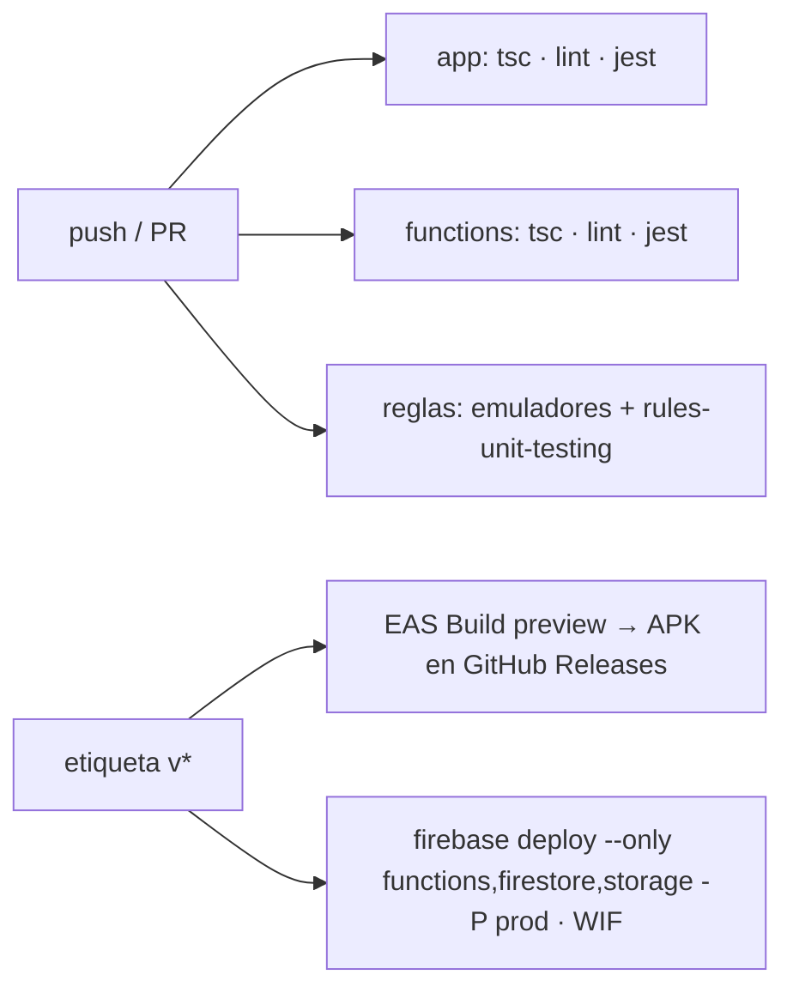

# 04 · Infraestructura

> Todo lo que existe fuera del código: proyectos, recursos, permisos, entornos, CI/CD, costos y la puesta en marcha desde cero. Base común: `../../planeacion/00-estandar-tecnico-comun.md` (fuera de este repo).

## Proyectos y entornos

| Entorno | Proyecto de Firebase/GCP                     | Variante de la app                   | Paquete Android                |
| ------- | -------------------------------------------- | ------------------------------------ | ------------------------------ |
| `local` | Emulator Suite (`demo-ecoreporte`, sin nube) | `development`                        | `com.juliancvm.ecoreporte.dev` |
| `dev`   | `ecoreporte-dev`                             | `development` / `preview`            | `com.juliancvm.ecoreporte.dev` |
| `prod`  | `ecoreporte-prod`                            | `production` y el APK del portafolio | `com.juliancvm.ecoreporte`     |

`.firebaserc` define los alias `dev` y `prod`. El nombre `demo-*` hace que los emuladores no intenten hablar con la nube.

## Recursos por proyecto

| Recurso                    | Configuración                                                                                                   | Región                                         |
| -------------------------- | --------------------------------------------------------------------------------------------------------------- | ---------------------------------------------- |
| Plan                       | **Blaze** + presupuesto de USD 10/mes con alertas al 50/90/100 %                                                | —                                              |
| Firestore                  | Modo nativo, base `(default)`, copias de seguridad programadas diarias con retención de 7 días                  | `us-east1` (**no se puede cambiar**, ADR 0005) |
| Cloud Storage for Firebase | Bucket por defecto                                                                                              | `us-east1`                                     |
| Cloud Functions 2.ª gen    | `classifyReportPhoto` (Storage), `onReportStatusChange` (Firestore), `purgeRejectedPhotos` (programada, diaria) | `us-east1`                                     |
| Vertex AI                  | API habilitada; modelo en `GEMINI_MODEL`                                                                        | `VERTEX_LOCATION` (por defecto `us-east1`)     |
| Authentication             | Correo/contraseña y Google                                                                                      | —                                              |
| FCM                        | Temas `operators` y por usuario (token)                                                                         | —                                              |
| App Check                  | Play Integrity (Android), DeviceCheck/App Attest (iOS); token de depuración en dev                              | —                                              |
| Crashlytics, Analytics     | Habilitados                                                                                                     | —                                              |
| Remote Config              | Plantilla con las claves de `05-parametrizacion.md`                                                             | —                                              |
| Maps SDK for Android/iOS   | Clave restringida por paquete + SHA-1 y por API                                                                 | —                                              |

**APIs que se habilitan:** Firestore, Cloud Storage, Cloud Functions, Cloud Run, Eventarc, Pub/Sub, Cloud Build, Artifact Registry, Cloud Scheduler, Secret Manager, Vertex AI, Firebase Installations, FCM, App Check, Maps SDK.

## Identidades y permisos (mínimo privilegio)

| Cuenta de servicio            | Para                                    | Roles                                                                                                                                                                                                           |
| ----------------------------- | --------------------------------------- | --------------------------------------------------------------------------------------------------------------------------------------------------------------------------------------------------------------- |
| `fn-runtime@`                 | Ejecutar las funciones                  | `roles/datastore.user`, `roles/storage.objectAdmin` (solo en el bucket), `roles/aiplatform.user`, `roles/firebasecloudmessaging.admin`, `roles/eventarc.eventReceiver`, `roles/logging.logWriter`               |
| `ci-deployer@`                | Despliegue desde GitHub Actions con WIF | Desplegar funciones, reglas e índices, y `roles/iam.serviceAccountUser` sobre `fn-runtime@`. **[POR CONFIRMAR]** la lista exacta en el primer despliegue: se parte de la documentación de Firebase y se recorta |
| Agente de servicio de Storage | Publicar los eventos del bucket         | `roles/pubsub.publisher` (lo suele configurar el CLI de Firebase)                                                                                                                                               |

**Workload Identity Federation:** un pool `github`, un proveedor OIDC `token.actions.githubusercontent.com` y una condición `attribute.repository == "JulianCVM/ecoreporte"`. **No se crean llaves JSON.**

**Roles de usuario:** custom claims `role: operator | admin`, asignados con `functions/scripts/set-role.ts` (Admin SDK y credenciales de la persona administradora, ejecutado en local). Nunca desde la app.

## Secretos y archivos sensibles

| Qué                                                              | Dónde                                                                                 | En git |
| ---------------------------------------------------------------- | ------------------------------------------------------------------------------------- | ------ |
| `google-services.json` / `GoogleService-Info.plist` (dev y prod) | Variables de EAS de tipo archivo: `GOOGLE_SERVICES_JSON`, `GOOGLE_SERVICE_INFO_PLIST` | No     |
| Clave de Maps                                                    | Variable de EAS `GOOGLE_MAPS_API_KEY` (la lee `app.config.ts`)                        | No     |
| Token de depuración de App Check                                 | `.env` local                                                                          | No     |
| Credenciales de GCP de la CI                                     | No existen (WIF)                                                                      | —      |
| Keystore de Android                                              | Lo administra EAS                                                                     | No     |

## CI/CD

- `.github/workflows/ci.yml` corre A en cada push. B y C se agregan cuando existan `functions/` y las pruebas de reglas.
- El despliegue a `dev` es manual (`firebase deploy -P dev`). El de `prod` solo sale de una etiqueta.

## Costos esperados (uso de demo)

| Servicio                                  | Supuesto                   | Costo esperado                                                                                  |
| ----------------------------------------- | -------------------------- | ----------------------------------------------------------------------------------------------- |
| Firestore, Storage, Functions             | Cientos de reportes al mes | Dentro de la capa gratuita                                                                      |
| Vertex AI (Gemini Flash)                  | ≤ 500 imágenes al mes      | Centavos de dólar. **[POR MEDIR]** con los tokens que registra `evaluations`                    |
| Maps SDK móvil                            | Uso de demo                | Gratis en las SDK móviles. **[POR CONFIRMAR]** las condiciones vigentes de Google Maps Platform |
| Artifact Registry (imágenes de Functions) | Pocas versiones            | Céntimos; política de limpieza de imágenes viejas                                               |

**Topes en el código:** `maxInstances` de `classifyReportPhoto` = `AI_MAX_INSTANCES` (3), `REPORTS_PER_USER_PER_DAY` (10) e interruptor `AI_ENABLED`.

## Observabilidad

- **Crashlytics:** errores de la app, con `reportId` como clave personalizada en el flujo de reporte.
- **Analytics:** eventos en `05-parametrizacion.md`.
- **Cloud Logging:** cada función registra JSON con `reportId`, `status`, `latencyMs` y `model`. Métrica basada en logs para `ai.latencyMs` (RNF01).
- **Alerta:** tasa de error de `classifyReportPhoto` > 10 % en 1 h → correo.

## Recuperación (RNF02)

1. Restaurar la copia de seguridad diaria de Firestore en una base nueva (`gcloud firestore databases restore`) y apuntar a ella, o importar sobre la base existente.
2. Storage: las fotos no se borran salvo por la purga de rechazados; se activa la _soft delete_ del bucket (7 días).
3. Functions: se despliegan de nuevo desde la etiqueta.
4. Meta: RTO ≤ 4 h. **[POR MEDIR]** con un simulacro antes de cerrar la app.

## Puesta en marcha desde cero (runbook)

1. Crear `ecoreporte-dev` en la consola de Firebase, pasarlo a Blaze y **crear primero el presupuesto con alertas**.
2. Crear Firestore en `us-east1`, la Storage por defecto, Authentication (correo y Google) y registrar las apps Android (`.dev`) e iOS.
3. Descargar `google-services.json` y subirlo a EAS: `npx eas-cli@latest env:create --name GOOGLE_SERVICES_JSON --type file --environment development`.
4. Habilitar Vertex AI, crear `fn-runtime@` y darle sus roles.
5. `npm i -g firebase-tools` → `firebase login` → `firebase use --add` (alias `dev`).
6. `firebase deploy -P dev --only firestore:rules,firestore:indexes,storage`.
7. `firebase deploy -P dev --only functions`.
8. Configurar WIF y `ci-deployer@` (solo para `prod`).
9. Repetir 1–7 con `ecoreporte-prod` cuando el MVP pase en dev.
