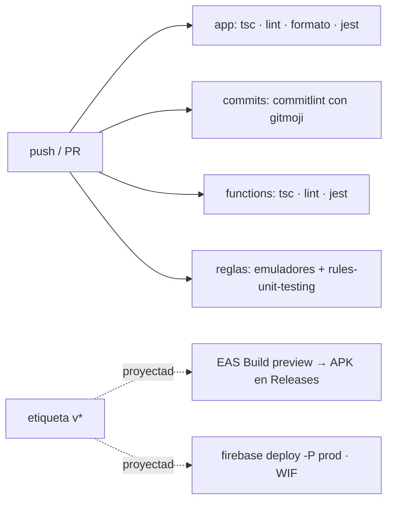

# 04 · Infraestructura

> Todo lo que existe fuera del código: proyectos, recursos, permisos, entornos, CI/CD, costos y la puesta en marcha desde cero. Base común: `planeacion/00-estandar-tecnico-comun.md` de la carpeta `AppsMoviles` (fuera de este repo).

## Principio: costo cero hoy, producción proyectada ([ADR 0007](adr/0007-costo-cero-con-spark-y-emuladores.md))

No hay presupuesto, así que **nada de lo que hoy corre puede pedir tarjeta**.

- **Desarrollo:** todo lo que en la nube exige el plan Blaze (Cloud Functions, Storage, Vertex AI) corre en la **Firebase Emulator Suite**, en el PC.
- **Proyecto en la nube `ecoreporte-dev`, plan Spark (gratis):** solo se usa para lo que es gratis y no se puede emular: la configuración de la app, FCM, Crashlytics, Analytics y Remote Config.
- **Producción:** queda **diseñada y costeada**, lista para activarse con plan Blaze el día que haya presupuesto, sin cambiar el código: solo cambian la configuración y los parámetros.

## Entornos

| Entorno                     | Qué corre dónde                                                                                                                                                                   | Variante de la app | Paquete Android                | Costo                       |
| --------------------------- | --------------------------------------------------------------------------------------------------------------------------------------------------------------------------------- | ------------------ | ------------------------------ | --------------------------- |
| `local` (**el de trabajo**) | Auth, Firestore, Storage y Functions en los emuladores. IA con `AI_PROVIDER=gemini-api` (capa gratuita) o `mock`. FCM, Crashlytics, Analytics y Remote Config en `ecoreporte-dev` | `development`      | `com.juliancvm.ecoreporte.dev` | USD 0                       |
| `ci`                        | Emuladores dentro de GitHub Actions, IA en `mock`                                                                                                                                 | —                  | —                              | USD 0 (repositorio público) |
| `prod` (**proyectado**)     | Todo en `ecoreporte-prod` con plan Blaze; IA en Vertex AI                                                                                                                         | `production`       | `com.juliancvm.ecoreporte`     | Ver «Costos proyectados»    |

`.firebaserc` define el alias `default = demo-ecoreporte` para los emuladores (el prefijo `demo-` impide que toquen la nube) y `dev = ecoreporte-dev`.

**Por qué la app usa `ecoreporte-dev` aunque los datos estén en los emuladores:** el SDK nativo necesita un `google-services.json` real para arrancar. Con ese archivo, Crashlytics, Analytics, FCM y Remote Config funcionan contra la nube (gratis), y Auth, Firestore, Storage y Functions se redirigen a los emuladores con `EXPO_PUBLIC_USE_EMULATORS=true`.

**Por qué los emuladores corren con `--project dev`:**

- El cliente se identifica con el `project_id` de su `google-services.json` (`ecoreporte-dev`).
- Con `singleProjectMode`, los emuladores rechazan un proyecto distinto del suyo.
- Las pruebas de reglas, en cambio, usan el proyecto `demo-ecoreporte` (el `default` de `.firebaserc`), que nunca toca la nube.
- La conexión vive en `src/lib/firebase/`; `emulatorTargets()` decide host y puertos, y nunca conecta en `prod`.

## Qué permite cada plan

| Servicio                                   | Spark (hoy)                                                                                            | Emulador                                      | Blaze (prod proyectada)    |
| ------------------------------------------ | ------------------------------------------------------------------------------------------------------ | --------------------------------------------- | -------------------------- |
| Authentication (correo, Google)            | ✅                                                                                                     | ✅                                            | ✅                         |
| Firestore                                  | ✅ con cuota diaria                                                                                    | ✅                                            | ✅                         |
| Cloud Storage for Firebase                 | ❌ desde 2024 exige Blaze                                                                              | ✅                                            | ✅                         |
| Cloud Functions                            | ❌ exige Blaze                                                                                         | ✅                                            | ✅                         |
| Vertex AI                                  | ❌ exige facturación                                                                                   | —                                             | ✅                         |
| Gemini Developer API (AI Studio)           | ✅ capa gratuita con clave, sin tarjeta                                                                | Se llama desde el emulador de Functions       | Se reemplaza por Vertex AI |
| FCM, Crashlytics, Analytics, Remote Config | ✅ gratis                                                                                              | FCM no se emula                               | ✅                         |
| App Check                                  | ✅ (proveedor de depuración en desarrollo)                                                             | —                                             | ✅ Play Integrity          |
| Mapas                                      | MapLibre + teselas de OpenFreeMap, sin clave ([ADR 0008](adr/0008-mapa-con-maplibre-y-openfreemap.md)) | —                                             | Igual                      |
| Copias de seguridad de Firestore           | ❌                                                                                                     | Exportación del emulador (`--export-on-exit`) | ✅ programadas             |

**[POR CONFIRMAR]** al usar cada servicio: los límites de la capa gratuita de la Gemini Developer API (solicitudes por minuto y por día) y si esa capa usa los datos para mejorar productos de Google. Mientras sea así, en desarrollo **solo se usan fotos de prueba sin personas**.

## Recursos de `ecoreporte-dev` (Spark, creado el 2026-11-18)

| Recurso                | Configuración                                                                                                                                                                |
| ---------------------- | ---------------------------------------------------------------------------------------------------------------------------------------------------------------------------- |
| App Android            | `com.juliancvm.ecoreporte.dev` → `google-services.json` en la raíz, fuera de git. **[HECHO] 2026-11-18**. Falta registrar la SHA-1 (la necesitan Google Sign-In y App Check) |
| Authentication         | Correo/contraseña y Google (necesita la huella SHA-1 del keystore de depuración)                                                                                             |
| FCM                    | Temas `operators` y tokens por usuario                                                                                                                                       |
| Crashlytics, Analytics | Habilitados                                                                                                                                                                  |
| Remote Config          | Plantilla con las claves de `05-parametrizacion.md`                                                                                                                          |
| App Check              | Proveedor de depuración                                                                                                                                                      |

Auth y Firestore en la nube **no se usan** mientras se trabaje con emuladores. Así no hay datos de prueba dispersos ni consumo de cuota.

## Emuladores (`firebase.json`)

| Emulador  | Puerto | Notas                                                        |
| --------- | ------ | ------------------------------------------------------------ |
| Auth      | 9099   |                                                              |
| Firestore | 8080   | Reglas de `firebase/firestore.rules`                         |
| Storage   | 9199   | Reglas de `firebase/storage.rules`                           |
| Functions | 5001   | Lee los secretos de `functions/.secret.local` (fuera de git) |
| Interfaz  | 4000   | Para ver datos, logs y disparar funciones                    |

- Datos persistentes entre sesiones: `firebase emulators:start --import=.emulator-data --export-on-exit` (carpeta fuera de git).
- Desde el emulador de Android se llega al PC por `10.0.2.2`. Desde un celular físico, por la IP del PC en la red local (`EXPO_PUBLIC_EMULATOR_HOST`), con los emuladores escuchando en `0.0.0.0`.
- Los emuladores necesitan Java 21 o superior y `firebase-tools` (`npm i -D firebase-tools` en el repo, para fijar la versión).

## Secretos y archivos sensibles

| Qué                                          | Dónde                                                                                                                                                                                                                                         | En git |
| -------------------------------------------- | --------------------------------------------------------------------------------------------------------------------------------------------------------------------------------------------------------------------------------------------- | ------ |
| `google-services.json` de `ecoreporte-dev`   | Raíz del repo (local)                                                                                                                                                                                                                         | No     |
| `GEMINI_API_KEY` (capa gratuita)             | `functions/.secret.local`                                                                                                                                                                                                                     | No     |
| Token de depuración de App Check             | `.env`                                                                                                                                                                                                                                        | No     |
| Credencial para enviar FCM desde el emulador | Opcional. Una llave de cuenta de servicio **solo local**, fuera del repo, con `roles/firebasecloudmessaging.admin` y nada más. Se revoca al terminar la app. Sin ella, `FCM_ENABLED=false` y las push se prueban desde la consola de Firebase | No     |
| Keystore de Android                          | El de depuración para desarrollo; el de publicación lo administraría EAS en producción                                                                                                                                                        | No     |

## CI/CD (gratis: el repositorio es público)

- Hoy corren A y M. B y C se agregan cuando existan `functions/` y las pruebas de reglas.
- **APK del portafolio:**
  - Se genera en local con `npx expo run:android --variant release`, o con EAS Build dentro de la cuota gratuita mensual de Expo **[POR CONFIRMAR los límites vigentes]**.
  - Se sube a GitHub Releases.
  - Apunta a los emuladores: para el demo se graba el video en local.

## Producción proyectada (no se activa sin presupuesto)

| Recurso           | Configuración prevista                                                                                                                                                                                                                                                                                                                |
| ----------------- | ------------------------------------------------------------------------------------------------------------------------------------------------------------------------------------------------------------------------------------------------------------------------------------------------------------------------------------- |
| Plan              | Blaze + presupuesto de USD 5/mes con alertas al 50/90/100 % **antes** de crear recursos                                                                                                                                                                                                                                               |
| Firestore         | `us-east1` (no se puede cambiar, [ADR 0005](adr/0005-entornos-y-region.md)); copias diarias con retención de 7 días                                                                                                                                                                                                                   |
| Storage           | Bucket por defecto en `us-east1`; _soft delete_ de 7 días                                                                                                                                                                                                                                                                             |
| Functions 2.ª gen | `classifyReportPhoto`, `onReportStatusChange`, `purgeRejectedPhotos` en `us-east1`, `maxInstances` bajos                                                                                                                                                                                                                              |
| IA                | `AI_PROVIDER=vertex`, cuenta `fn-runtime@` con `roles/aiplatform.user` (sin claves de API)                                                                                                                                                                                                                                            |
| IAM               | `fn-runtime@`: `roles/datastore.user`, `roles/storage.objectAdmin` (en el bucket), `roles/aiplatform.user`, `roles/firebasecloudmessaging.admin`, `roles/eventarc.eventReceiver`, `roles/logging.logWriter`. `ci-deployer@` con Workload Identity Federation (sin llaves JSON); los roles exactos se recortan en el primer despliegue |
| App Check         | Play Integrity (requiere distribuir por Google Play: cuenta de desarrollador de pago único, **costo aparte**)                                                                                                                                                                                                                         |

### Costos proyectados (uso de demo: ≤ 500 reportes/mes)

| Servicio                                  | Supuesto                                                                               | Costo estimado                                                          |
| ----------------------------------------- | -------------------------------------------------------------------------------------- | ----------------------------------------------------------------------- |
| Firestore, Storage, Functions             | Cientos de documentos, < 1 GB de fotos, miles de invocaciones                          | USD 0: dentro de las cuotas sin costo de Blaze                          |
| Vertex AI (Gemini Flash)                  | 500 imágenes/mes                                                                       | Menos de USD 1. **[POR MEDIR]** con los tokens que guarda `evaluations` |
| Artifact Registry (imágenes de Functions) | Pocas versiones con política de limpieza                                               | Menos de USD 0,10                                                       |
| Cloud Scheduler                           | 1 tarea                                                                                | USD 0 (3 tareas gratis por cuenta)                                      |
| **Total mensual esperado**                |                                                                                        | **USD 0–2**, con tope de presupuesto de USD 5                           |
| Pagos únicos opcionales                   | Cuenta de Google Play (para Play Integrity y la tienda) y Apple Developer (iOS, anual) | Fuera del plan actual                                                   |

## Observabilidad

- **Crashlytics:** errores de la app, con `reportId` como clave personalizada en el flujo de reporte. Gratis desde hoy.
- **Analytics:** los eventos de `05-parametrizacion.md`. Gratis desde hoy.
- **Logs de las funciones:** JSON con `reportId`, `status`, `latencyMs` y `model`. En local se ven en la interfaz del emulador; en producción, en Cloud Logging.

## Recuperación

- **Hoy:** los datos de desarrollo se exportan con `--export-on-exit` y se pueden borrar sin pérdida real.
- **Producción proyectada (RNF02):**
  - copia diaria de Firestore y restauración en una base nueva;
  - _soft delete_ del bucket;
  - redespliegue de Functions desde la etiqueta.
  - Meta: RTO ≤ 4 h.

## Puesta en marcha desde cero (local)

1. En `ecoreporte-dev` (plan Spark), registrar la app Android `com.juliancvm.ecoreporte.dev` con la SHA-1 de depuración y descargar `google-services.json` a la raíz del repo. La SHA-1 se obtiene con `keytool -list -v -keystore ~/.android/debug.keystore -alias androiddebugkey -storepass android` (con el `keytool` del JBR de Android Studio).
2. Habilitar Authentication (correo y Google), Crashlytics y Remote Config.
3. Crear una clave en Google AI Studio (sin tarjeta) y guardarla en `functions/.secret.local` como `GEMINI_API_KEY=...`.
4. `npm install` → `cp .env.example .env`.
5. `npm run emulators`. Carga los datos de `.emulator-data/` y los guarda al salir con Ctrl+C. Para empezar sin datos: `npm run emulators:limpio`. Usa el Java 21 de Android Studio: en Windows, `. .\scripts\entorno-android.ps1`. Con un JDK más nuevo en el `PATH`, el emulador de Storage avisa errores del runtime de reglas. Mientras no exista `functions/` (#5), el script levanta solo Auth, Firestore y Storage; si se pide el emulador de Functions sin su configuración, el CLI se cae (`Extensions Emulator is running but Functions emulator is not`). La interfaz queda en <http://localhost:4000>.
6. En otra terminal: `npm run android`.
